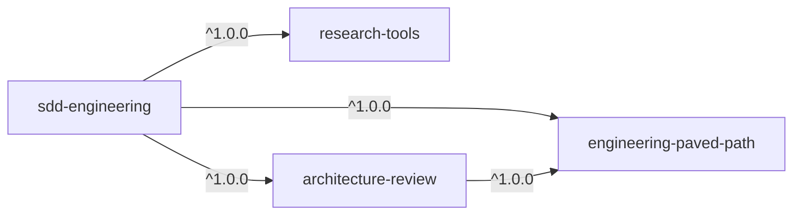

# Dev Digest AI Marketplace

Claude Code plugin marketplace.

## Install

```bash
/plugin marketplace add aptrnk1/dev-digest-ai-marketplace
/plugin install <plugin>@dev-digest-ai-marketplace
```

Added the marketplace before it was renamed from `dev-digest`? Re-add it, then reinstall your plugins with the new suffix:

```bash
/plugin marketplace remove dev-digest
/plugin marketplace add aptrnk1/dev-digest-ai-marketplace
```

## Plugins

| Plugin | Description |
| :- | :- |
| [sdd-engineering](plugins/sdd-engineering) | Spec Driven Development pipeline: spec, implementation plan, run-plan, verification and workflow retro |
| [architecture-review](plugins/architecture-review) | Read-only architecture reviewer agent: layers, dependency direction, module boundaries |
| [research-tools](plugins/research-tools) | Read-only researcher agent: answers a concrete question from the codebase or the web with cited evidence |
| [engineering-paved-path](plugins/engineering-paved-path) | Stack skills for React, Next.js, Fastify, onion architecture, React Testing Library and web security |
| [hello](plugins/hello) | Example plugin: a greeting skill that shows the marketplace layout |

`sdd-engineering` installs its dependencies automatically:



## Adding a plugin

Full rules: [docs/plugin-authoring.md](docs/plugin-authoring.md), [docs/release-process.md](docs/release-process.md), [docs/review-checklist.md](docs/review-checklist.md).

1. Create `plugins/<name>/.claude-plugin/plugin.json` with the same `name` as the folder.
2. Put components at the plugin root: `skills/`, `agents/`, `commands/`, `hooks/hooks.json`, `.mcp.json`.
3. Add an entry to `.claude-plugin/marketplace.json` with `"source": "./plugins/<name>"`.
4. Run `claude plugin validate . --strict`, then test locally:
   `claude plugin marketplace add ./` and `claude plugin install <name>@dev-digest-ai-marketplace`.

Conventions:

- Keep the entry `name` and `plugin.json` `name` identical and never rename them; use `displayName` or the `renames` map.
- Set `version` (semver) only in `plugin.json`, never in the marketplace entry, and bump it on every change: users don't receive commits made without a bump ([ADR-0002](docs/adr/0002-versioning-strategy.md)).
- Plugins that others depend on with a range such as `^1.0.0` need release tags `<plugin>--v<version>` on `main` (`git tag <plugin>--v<version>`, or `claude plugin tag --push` from the plugin directory). Tag dependencies before the plugins that depend on them.
- Reference another plugin's skills and agents by namespaced name, e.g. `engineering-paved-path:onion-architecture`.
- Quote `"${CLAUDE_PLUGIN_ROOT}"` in hooks and call scripts through an interpreter (`bash`, `node`).
- No secrets in `.mcp.json`; use `userConfig` with `"sensitive": true`.

Plugins run hooks and MCP servers with your permissions; review them before installing.
