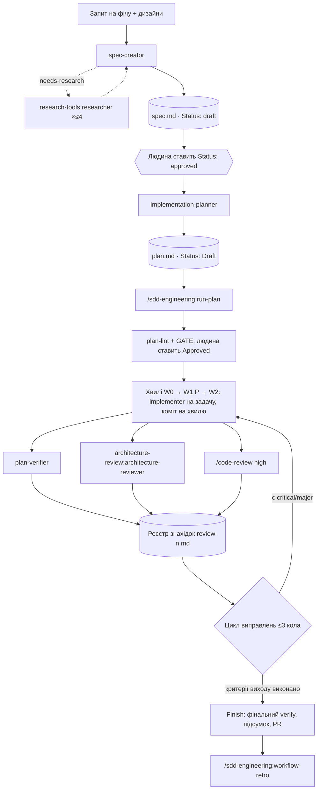

# SDD Engineering

Конвеєр Spec Driven Development для Claude Code: ідея → спека з EARS-критеріями →
план імплементації хвилями → код test-first → перевірка плану й архітектури →
цикл виправлень → ретроспектива прогону. Плагін не прив'язаний до мови, фреймворку
чи структури репо: шляхи й команди перевірок він бере з параметрів, плану і
`CLAUDE.md` вашого проєкту.

Для кого: команди й інженери, які хочуть, щоб фіча проходила через затверджену
спеку і план, а не одразу йшла в код. Агенти працюють у чистому контексті, кожен
має вузьку роль і обмежений доступ на запис.

## Встановлення

```bash
/plugin marketplace add aptrnk1/dev-digest-ai-marketplace
/plugin install sdd-engineering@dev-digest
```

Разом із плагіном автоматично встановлюються й вмикаються його залежності (діапазон
`^1.0.0`):

| Залежність | Що дає конвеєру |
| :- | :- |
| [`engineering-paved-path`](../engineering-paved-path) | stack-skills: React, Next.js, Fastify, onion architecture, React Testing Library, security. Planner вписує їх у поле `Skills:` задачі, implementer вантажить лише їх |
| [`research-tools`](../research-tools) | агент `research-tools:researcher`, який `spec-creator` запускає, коли бракує фактів |
| [`architecture-review`](../architecture-review) | агент `architecture-review:architecture-reviewer` для фінального й проміжного рев'ю структури |

Після оновлення плагіна виконайте `/reload-plugins`, щоб довантажити нові залежності.

## Як працює конвеєр



Спеку і план ви запускаєте вручну. `/sdd-engineering:run-plan` бере вже готовий план,
тож між етапами завжди є людське рішення: спека `approved`, план `Approved`.

## Компоненти

| Компонент | Модель | Етап | Вхід | Вихід | Запис |
| :- | :- | :- | :- | :- | :- |
| `sdd-engineering:spec-creator` (агент) | opus, ≤40 ходів | 1. Спека | запит, дизайни, код | `<specs_dir>/YYYY-MM-DD-<slug>.md`, `Status: draft` | лише файли спек, лише draft (guard-хук); Bash вимкнено |
| `sdd-engineering:implementation-planner` (агент) | opus | 2. План | затверджена спека або вимоги в делегуванні | `<plans_dir>/<feature>.md` | лише файл плану (guard-хук) |
| `sdd-engineering:implementer` (агент) | sonnet, ≤60 ходів | 3. Код | план + `task: T<n>` | код і тести задачі, звіт `T<n>.md` | лише файли з `Owns` своєї задачі |
| `sdd-engineering:plan-verifier` (агент) | sonnet, ≤50 ходів | 4. Перевірка | план (+ `base:`, `tasks:`) | traceability-матриця, вердикт `COMPLETE`/`INCOMPLETE` | немає (read-only) |
| `/sdd-engineering:run-plan` (skill) | сесія | 3–6 | `plan: <path>` | гілка `feature/<slug>`, коміти, `flow.md`, реєстри рев'ю | через агентів і коміти |
| `/sdd-engineering:workflow-retro` (skill) | сесія | 7. Ретро | поточна сесія або `--session` | `<retros_dir>/YYYY-MM-DD-<slug>.md` | лише звіт ретро |
| `sdd-engineering:spec-authoring` (skill) | — | 1 | — | EARS, матриця станів UI, межі довіри для LLM, Mermaid, шаблон спеки, `save-designs.mjs` | — |

### spec-creator

Аналізує запит і дизайни (матриця «екран × стан», дії, яких немає на макеті),
взаємодію модулів, довіру до входів, edge cases і NFR. Ставить уточнювальні питання і
пропозиції `REC1…` з рекомендованим варіантом до того, як щось записати. Пише спеку
українською: user stories `US1…`, EARS-критерії
`**AC<n>** (<тип>, US<n>) … [unit|it|e2e|manual]`, `EC1…`, вимірні `NFR1…`, Open
questions, traceability-матриця. Ставить лише `Status: draft`. `approved` і
`implemented` ставить людина.

### implementation-planner

Перевіряє вимоги: прогалини, конфлікти з кодом і правилами `CLAUDE.md`, AC, які не
можна перевірити. Питає про незрозуміле і завжди уточнює режим виконання. Пише план за
шаблоном [`skills/run-plan/templates/plan.md`](skills/run-plan/templates/plan.md):
хвилі `W0` (foundation, послідовно) → `W1` (паралельні `[P]`) → `W2` (інтеграція, e2e).
Кожна задача має тег `[SHARED|BE|FE]`, неперетинний `Owns`, `Skills`, `Route`,
`Interfaces`, `Acceptance` з посиланнями на AC/R, точні команди `Verify` і
`Escalate if`. Розділ `## Commands` фіксує реальні команди перевірок вашого репо.
Спеку без `Status: approved` або з blocking Open questions агент не планує.

### implementer

Виконує рівно одну задачу `T<n>`. Вантажить лише skills з поля `Skills:` задачі,
працює test-first (red → green → refactor) і наприкінці запускає `Verify` задачі.
Повертає статус `DONE | DONE_WITH_CONCERNS | NEEDS_CONTEXT | BLOCKED`. Кілька
екземплярів можуть працювати паралельно у worktree, бо кожен редагує лише свій `Owns`.
У режимі виправлень (`fixes:`) може відповісти `DISPUTED` з доказами.

### plan-verifier

Відповідає на одне питання: чи реально реалізовано кожен пункт плану. Будує матрицю
Req → задача → `file:line` → тест → команда. Перевіряє в обидва боки: кожна вимога має
код, і кожен змінений файл належить чиємусь `Owns`. Запускає `Verify` як свіжий доказ,
а `## Progress` і звіти implementer вважає лише заявами. Статуси пунктів:
`DONE | PARTIAL | MISSING | UNVERIFIABLE | DEVIATION`. `UNVERIFIABLE` ніколи не стає `DONE`.

### run-plan

`/sdd-engineering:run-plan plan: <path> [until: impl]` — оркестратор у головній сесії.
Запускає `plan-lint.mjs` і показує план на GATE, а після вашого Approve працює
автономно. Хвилі йдуть на гілці `feature/<slug>`, по коміту на хвилю. Фінальне рев'ю
запускає паралельно `plan-verifier`, `architecture-reviewer` і `/code-review high` і
збирає їхні знахідки в один реєстр `review-<n>.md`. Далі цикл виправлень: critical і
major виправляються обов'язково, minor — попутно, nit — ні, не більше 3 кіл, потім
ескалація до вас. Питання агентів skill передає вам через `AskUserQuestion` і
продовжує того самого агента через `SendMessage`. Сам skill не викликається моделлю
(`disable-model-invocation`), лише вами.

Економія токенів без втрати перевірок:
- implementer пише повний звіт у файл, а оркестратору повертає до 15 рядків;
- задача з `Route: inline | agent:haiku | agent` виконується найдешевшим способом:
  дрібну правку оркестратор робить сам, механічну задачу виконує `haiku`;
- повний gate модуля запускається раз після хвилі, implementer ганяє лише свій `Verify`;
- друге коло рев'ю працює в delta-режимі (`previous` + `since`);
- виправлення повертаються тому самому implementer через `SendMessage`.

### workflow-retro

Рахує з локальних транскриптів токени по агентах і оркестратору, порядок запусків,
активний і загальний час, упирання в ліміт ходів, помилки інструментів і файли, які
читали кілька агентів. Для цього запускає скрипт
`node "${CLAUDE_SKILL_DIR}/scripts/workflow-stats.mjs"`. На основі цифр і звітів агентів
пише, що йшло важко, що легко, що дублювалось і що пропустили, плюс рекомендації з
доказами. Сам нічого не править.

## Параметри та їхні дефолти

Усі параметри передаються в делегуванні агенту або в аргументах skill (`specs_dir: docs/specs/`).

`specs_dir` і `plans_dir` — це ще й налаштування плагіна: guard-хуки дозволяють запис
лише туди. Якщо у вашому репо спеки лежать деінде, задайте їх один раз:

```text
/plugin configure sdd-engineering@dev-digest
```

Агенти беруть ці значення як дефолти, тож хук і агент не розійдуться.

| Параметр | Дефолт | Хто використовує |
| :- | :- | :- |
| `specs_dir` | `specs/` | spec-creator, implementation-planner, guard-хуки |
| `plans_dir` | `specs/plans/` | implementation-planner, run-plan, plan-verifier, guard-хуки |
| `reports_dir` | `<plans_dir>/reports/` | run-plan, implementer, plan-verifier |
| `designs_dir` | `<specs_dir>/designs/` | spec-creator, `save-designs.mjs`, implementation-planner |
| `retros_dir` | `.claude/retros/` | workflow-retro |
| `testing_doc` | немає | spec-creator, planner, implementer: документ з тестовими лейнами (`unit`, `it`, `e2e`) |
| `arch_check` | немає | run-plan → architecture-reviewer: команда перевірки напряму імпортів (наприклад dependency-cruiser) |
| `bootstrap` | немає | run-plan: команда, що готує новий worktree (встановити або прилінкувати залежності) |

Команди перевірок (typecheck, lint, тести, інтеграційні тести) плагін не вгадує.
Planner бере їх із `CLAUDE.md`, README чи маніфесту пакета і записує в розділ
`## Commands` плану, а `Verify` кожної задачі використовує ті самі команди для своїх
файлів. Якщо в репо є власні шаблони `<specs_dir>/_template.md` або
`<plans_dir>/_template.md`, агенти беруть їх замість шаблонів плагіна.

## Guard-хуки

Агенти в плагіні ігнорують поле `hooks` у frontmatter, тому обмеження запису задано
в `hooks/hooks.json` плагіна як `PreToolUse` на `Write|Edit|MultiEdit`. Скрипт читає
`agent_type` зі stdin і діє лише для двох агентів:

- `sdd-engineering:spec-creator` може створювати лише `<specs_dir>/YYYY-MM-DD-<slug>.md`
  (або `<module>/specs/…`) і редагувати лише спеки зі `Status: draft`. У спеці, яку він
  заміщує, може змінити лише рядок `Status`;
- `sdd-engineering:implementation-planner` може писати лише в `<plans_dir>/<feature>.md`.

Для інших агентів і головної сесії хуки нічого не змінюють. Для розбору JSON потрібен
`jq`, а без нього `python3`. Якщо немає жодного, `spec-creator-guard` блокує запис.

Застереження:
- плагін запускає ці shell-скрипти з вашими правами, тож перегляньте їх перед
  встановленням;
- хук не бачить запис через Bash (`sed -i`, `cat >`). Тому в `spec-creator` Bash
  вимкнено повністю, а в `plan-verifier` «Bash лише для читання» тримається лише на
  промпті.

## Режими виконання й продовження

- **multi-agent**: один `implementer` на задачу, паралельні задачі `[P]` виконуються
  у worktree, хвиля за хвилею.
- **single-agent**: оркестратор сам виконує всі задачі послідовно в основному checkout.
  Gate, коміт на хвилю і рев'ю лишаються.

Режим записується в заголовок плану як `Execution mode:`. Стан прогону лежить у
`<reports_dir>/<feature>/flow.md`: фаза, гілка, base sha, коло рев'ю. Щоб продовжити
перерваний прогін у новому чаті, ще раз запустіть
`/sdd-engineering:run-plan plan: <path>`. Skill прочитає `flow.md` і `## Progress` і
почне з першої незавершеної хвилі або з потрібної фази рев'ю.

## Агенти поодинці

Кожного агента можна викликати без `run-plan`, через `@agent-sdd-engineering:<name>`
або попросивши Claude делегувати йому задачу:

- `claude --agent sdd-engineering:spec-creator` запускає spec-creator як головну
  сесію. Лише так він сам запускає до 4 `research-tools:researcher` паралельно. Як
  сабагент він повертає блок `needs-research`, а оркестратор запускає дослідників і
  повертає звіти в полі `research:`;
- коли агенту треба щось у вас спитати, а `AskUserQuestion` недоступний, він повертає
  блок `needs-input`. Відповідь передається тому самому агенту в полі `answers:`;
- `plan-verifier` можна запустити на будь-якому плані: `plan: <path>`, опційно
  `tasks: T1,T2` і `base: <ref>`.

## Артефакти на диску

```text
<specs_dir>/
  YYYY-MM-DD-<slug>.md          # спека (spec-creator)
  designs/YYYY-MM-DD-<slug>/    # D1.png, D2.png… (save-designs.mjs)
<plans_dir>/
  <feature>.md                  # план (implementation-planner)
  reports/<feature>/
    flow.md                     # стан прогону run-plan
    T<n>.md, T<n>-fix<k>.md     # звіти implementer
    verify-<sha>.md             # результати gate
    review-<n>.md               # реєстр знахідок
<retros_dir>/YYYY-MM-DD-<slug>.md  # ретро
```

## Evals

У `evals/` лежить по кейсу на кожен агент і workflow-skill. Кейси розгортають
маленький репо-фікстур через `scaffold.sh`, тому їм потрібні `--scaffold` і права на
запис:

```bash
claude plugin eval plugins/sdd-engineering --scaffold --ablation none \
  --allow-tools Write Edit "Bash(node *)" "Bash(git *)"
```

Кожен запуск — це реальні виклики моделі на вашому акаунті. Для ітерації над одним
кейсом додайте `--case <name> --runs 1`.

## Обмеження

- Сабагент не може запускати сабагентів. Тому `spec-creator` кличе `researcher` сам
  лише як головна сесія (`--agent`).
- `/code-review high` — зовнішній крок. Якщо цього skill у сесії немає, run-plan
  пропускає його і пише про це в реєстрі.
- e2e-перевірки запускаються лише тоді, коли план або документація репо кажуть, що
  хост їх підтримує. Інакше вони стають `UNVERIFIABLE` або `env`.
- Спеки пишуться українською.

## Джерела

Агенти і skills спираються на такі стандарти й патерни:

- Alistair Mavin, [EARS — Easy Approach to Requirements Syntax](https://alistairmavin.com/ears/), і ISO/IEC/IEEE 29148: форма й атрибути якості вимог.
- GitHub Spec Kit: [`spec-template.md`](https://github.com/github/spec-kit/blob/main/templates/spec-template.md), [`tasks-template.md`](https://github.com/github/spec-kit/blob/main/templates/tasks-template.md), [`analyze.md`](https://github.com/github/spec-kit/blob/main/templates/commands/analyze.md): ланцюжок spec → plan → tasks, маркер `[P]`, таблиця покриття вимог.
- obra/superpowers: [`implementer-prompt.md`](https://github.com/obra/superpowers/blob/main/skills/subagent-driven-development/implementer-prompt.md) (статуси звіту, один свіжий сабагент на задачу), [`verification-before-completion`](https://github.com/obra/superpowers/blob/main/skills/verification-before-completion/SKILL.md) (жодних заяв без свіжого доказу).
- Anthropic, [Building effective agents](https://www.anthropic.com/engineering/building-effective-agents): патерни orchestrator-workers і evaluator-optimizer.
- Anthropic, [How we built our multi-agent research system](https://www.anthropic.com/engineering/multi-agent-research-system): паралельні дослідники в чистому контексті.
- [OWASP Top 10 for LLM Applications 2025](https://genai.owasp.org/llm-top-10/), Nielsen Norman Group [10 Usability Heuristics](https://www.nngroup.com/articles/ten-usability-heuristics/), [WCAG 2.2](https://www.w3.org/TR/WCAG22/): аналіз довіри до входів і дизайнів.
- Kent Beck, *Test-Driven Development: By Example*: цикл red → green → refactor.
- Wikipedia, [Traceability matrix](https://en.wikipedia.org/wiki/Traceability_matrix).

Історія версій описана в [CHANGELOG.md](CHANGELOG.md).
