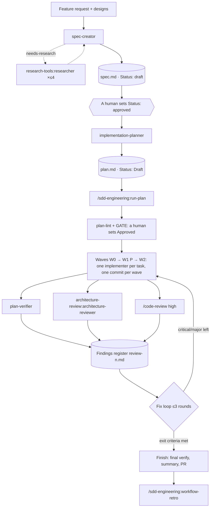

# SDD Engineering

A Spec Driven Development pipeline for Claude Code: idea → spec with EARS criteria →
implementation plan in waves → test-first code → plan and architecture verification →
fix loop → run retrospective. The plugin is not tied to a language, framework
or repo layout: it takes paths and check commands from parameters, the plan and
your project's `CLAUDE.md`.

Who it is for: teams and engineers who want a feature to go through an approved
spec and plan instead of straight into code. Agents work in a clean context, each
has a narrow role and limited write access.

## Installation

```bash
/plugin marketplace add aptrnk1/dev-digest-ai-marketplace
/plugin install sdd-engineering@dev-digest
```

The plugin's dependencies are installed and enabled automatically along with it (range
`^1.0.0`):

| Dependency | What it gives the pipeline |
| :- | :- |
| [`engineering-paved-path`](../engineering-paved-path) | stack skills: React, Next.js, Fastify, onion architecture, React Testing Library, security. The planner puts them in a task's `Skills:` field, the implementer loads only those |
| [`research-tools`](../research-tools) | the `research-tools:researcher` agent, which `spec-creator` dispatches when facts are missing |
| [`architecture-review`](../architecture-review) | the `architecture-review:architecture-reviewer` agent for final and intermediate structure reviews |

After updating the plugin, run `/reload-plugins` to load new dependencies.

## How the pipeline works



You start the spec and the plan by hand. `/sdd-engineering:run-plan` takes a finished plan,
so there is always a human decision between stages: spec `approved`, plan `Approved`.

## Components

| Component | Model | Stage | Input | Output | Writes |
| :- | :- | :- | :- | :- | :- |
| `sdd-engineering:spec-creator` (agent) | opus, ≤40 turns | 1. Spec | request, designs, code | `<specs_dir>/YYYY-MM-DD-<slug>.md`, `Status: draft` | spec files only, drafts only (guard hook); Bash disabled |
| `sdd-engineering:implementation-planner` (agent) | opus | 2. Plan | approved spec or requirements in the delegation | `<plans_dir>/<feature>.md` | the plan file only (guard hook) |
| `sdd-engineering:implementer` (agent) | sonnet, ≤60 turns | 3. Code | plan + `task: T<n>` | the task's code and tests, report `T<n>.md` | only files in its task's `Owns` |
| `sdd-engineering:plan-verifier` (agent) | sonnet, ≤50 turns | 4. Verification | plan (+ `base:`, `tasks:`) | traceability matrix, verdict `COMPLETE`/`INCOMPLETE` | none (read-only) |
| `/sdd-engineering:run-plan` (skill) | session | 3–6 | `plan: <path>` | branch `feature/<slug>`, commits, `flow.md`, review registers | through agents and commits |
| `/sdd-engineering:workflow-retro` (skill) | session | 7. Retro | current session or `--session` | `<retros_dir>/YYYY-MM-DD-<slug>.md` | the retro report only |
| `sdd-engineering:spec-authoring` (skill) | — | 1 | — | EARS, UI states matrix, LLM trust boundaries, Mermaid, spec template, `save-designs.mjs` | — |

### spec-creator

Analyses the request and designs (a "screen × state" matrix, actions missing from the design),
module interaction, input trust, edge cases and NFRs. Asks clarifying questions and
makes proposals `REC1…` with a recommended option before writing anything. Writes the spec
in English: user stories `US1…`, EARS criteria
`**AC<n>** (<type>, US<n>) … [unit|it|e2e|manual]`, `EC1…`, measurable `NFR1…`, Open
questions, a traceability matrix. It sets only `Status: draft`. `approved` and
`implemented` are set by a human. Older specs with the Ukrainian template headings
are still recognised.

### implementation-planner

Checks the requirements: gaps, conflicts with the code and `CLAUDE.md` rules, ACs that
cannot be verified. Asks about anything unclear and always confirms the execution mode. Writes the plan from
the template [`skills/run-plan/templates/plan.md`](skills/run-plan/templates/plan.md):
waves `W0` (foundation, sequential) → `W1` (parallel `[P]`) → `W2` (integration, e2e).
Each task has a `[SHARED|BE|FE]` tag, a non-overlapping `Owns`, `Skills`, `Route`,
`Interfaces`, `Acceptance` with AC/R references, exact `Verify` commands and
`Escalate if`. The `## Commands` section records your repo's real check commands.
The agent does not plan a spec without `Status: approved` or with blocking Open questions.

### implementer

Does exactly one task `T<n>`. Loads only the skills from the task's `Skills:` field,
works test-first (red → green → refactor) and runs the task's `Verify` at the end.
Returns a status `DONE | DONE_WITH_CONCERNS | NEEDS_CONTEXT | BLOCKED`. Several
instances can run in parallel in worktrees, because each edits only its own `Owns`.
In fix mode (`fixes:`) it may answer `DISPUTED` with evidence.

### plan-verifier

Answers one question: is every plan item really implemented. Builds the matrix
Req → task → `file:line` → test → command. Checks both ways: every requirement has
code, and every changed file belongs to someone's `Owns`. Runs `Verify` as fresh evidence,
and treats `## Progress` and implementer reports as claims only. Item statuses:
`DONE | PARTIAL | MISSING | UNVERIFIABLE | DEVIATION`. `UNVERIFIABLE` never becomes `DONE`.

### run-plan

`/sdd-engineering:run-plan plan: <path> [until: impl]` — the orchestrator in the main session.
Runs `plan-lint.mjs` and shows the plan at the GATE, and after your Approve works
autonomously. Waves run on the `feature/<slug>` branch, one commit per wave. The final review
runs `plan-verifier`, `architecture-reviewer` and `/code-review high` in parallel and
collects their findings into one register `review-<n>.md`. Then the fix loop: critical and
major are fixed mandatorily, minor along the way, nit not at all, at most 3 rounds, then
escalation to you. The skill relays agents' questions to you via `AskUserQuestion` and
continues the same agent via `SendMessage`. The skill is not invoked by the model
(`disable-model-invocation`), only by you.

Token savings without losing checks:
- the implementer writes the full report to a file and returns up to 15 lines to the orchestrator;
- a task with `Route: inline | agent:haiku | agent` runs the cheapest way:
  the orchestrator makes a tiny edit itself, a mechanical task goes to `haiku`;
- the module's full gate runs once after a wave, the implementer runs only its own `Verify`;
- the second review round works in delta mode (`previous` + `since`);
- fixes go back to the same implementer via `SendMessage`.

### workflow-retro

Counts from local transcripts the tokens per agent and orchestrator, launch order,
active and total time, turn-limit hits, tool errors and files that
several agents read. It runs the script
`node "${CLAUDE_SKILL_DIR}/scripts/workflow-stats.mjs"` for that. Based on the numbers and agent reports
it writes what was hard, what was easy, what was duplicated and what was missed, plus recommendations with
evidence. It edits nothing itself.

## Parameters and their defaults

All parameters are passed in the delegation to an agent or in skill arguments (`specs_dir: docs/specs/`).

`specs_dir` and `plans_dir` are also plugin settings: the guard hooks allow writes
only there. If your repo keeps specs elsewhere, set them once:

```text
/plugin configure sdd-engineering@dev-digest
```

Agents take these values as defaults, so the hook and the agent never disagree.

| Parameter | Default | Used by |
| :- | :- | :- |
| `specs_dir` | `specs/` | spec-creator, implementation-planner, guard hooks |
| `plans_dir` | `specs/plans/` | implementation-planner, run-plan, plan-verifier, guard hooks |
| `reports_dir` | `<plans_dir>/reports/` | run-plan, implementer, plan-verifier |
| `designs_dir` | `<specs_dir>/designs/` | spec-creator, `save-designs.mjs`, implementation-planner |
| `retros_dir` | `.claude/retros/` | workflow-retro |
| `testing_doc` | none | spec-creator, planner, implementer: a document with test lanes (`unit`, `it`, `e2e`) |
| `arch_check` | none | run-plan → architecture-reviewer: an import-direction check command (for example dependency-cruiser) |
| `bootstrap` | none | run-plan: a command that prepares a new worktree (install or link dependencies) |

The plugin does not guess check commands (typecheck, lint, tests, integration tests).
The planner takes them from `CLAUDE.md`, the README or the package manifest and writes them into the plan's
`## Commands` section, and each task's `Verify` uses the same commands for its
files. If the repo has its own `<specs_dir>/_template.md` or
`<plans_dir>/_template.md` templates, agents use them instead of the plugin's.

## Guard hooks

Plugin agents ignore the `hooks` field in frontmatter, so write restrictions are set
in the plugin's `hooks/hooks.json` as `PreToolUse` on `Write|Edit|MultiEdit`. The script reads
`agent_type` from stdin and acts only for two agents:

- `sdd-engineering:spec-creator` may create only `<specs_dir>/YYYY-MM-DD-<slug>.md`
  (or `<module>/specs/…`) and edit only specs with `Status: draft`. In the spec it
  supersedes it may change only the `Status` line;
- `sdd-engineering:implementation-planner` may write only to `<plans_dir>/<feature>.md`.

For other agents and the main session the hooks change nothing. Parsing JSON needs
`jq`, or `python3` without it. If neither is present, `spec-creator-guard` blocks the write.

Caveats:
- the plugin runs these shell scripts with your permissions, so review them before
  installing;
- the hook does not see writes through Bash (`sed -i`, `cat >`). That is why Bash is
  fully disabled in `spec-creator`, and in `plan-verifier` "read-only Bash" rests only on
  the prompt.

## Execution modes and resuming

- **multi-agent**: one `implementer` per task, parallel `[P]` tasks run
  in worktrees, wave after wave.
- **single-agent**: the orchestrator does all tasks itself, sequentially, in the main checkout.
  The gate, one commit per wave and the reviews remain.

The mode is recorded in the plan header as `Execution mode:`. The run state lives in
`<reports_dir>/<feature>/flow.md`: phase, branch, base sha, review round. To resume
an interrupted run in a new chat, run
`/sdd-engineering:run-plan plan: <path>` again. The skill reads `flow.md` and `## Progress` and
starts from the first unfinished wave or the right review phase.

## Agents on their own

Each agent can be called without `run-plan`, via `@agent-sdd-engineering:<name>`
or by asking Claude to delegate a task to it:

- `claude --agent sdd-engineering:spec-creator` runs spec-creator as the main
  session. Only then does it dispatch up to 4 `research-tools:researcher` in parallel itself. As a
  subagent it returns a `needs-research` block, and the orchestrator runs the researchers and
  returns the reports in the `research:` field;
- when an agent needs to ask you something and `AskUserQuestion` is unavailable, it returns
  a `needs-input` block. The answer goes back to the same agent in the `answers:` field;
- `plan-verifier` can run on any plan: `plan: <path>`, optionally
  `tasks: T1,T2` and `base: <ref>`.

## Artifacts on disk

```text
<specs_dir>/
  YYYY-MM-DD-<slug>.md          # spec (spec-creator)
  designs/YYYY-MM-DD-<slug>/    # D1.png, D2.png… (save-designs.mjs)
<plans_dir>/
  <feature>.md                  # plan (implementation-planner)
  reports/<feature>/
    flow.md                     # run-plan run state
    T<n>.md, T<n>-fix<k>.md     # implementer reports
    verify-<sha>.md             # gate results
    review-<n>.md               # findings register
<retros_dir>/YYYY-MM-DD-<slug>.md  # retro
```

## Evals

`evals/` holds one case per agent and workflow skill. The cases set up a
small fixture repo via `scaffold.sh`, so they need `--scaffold` and write
permissions:

```bash
claude plugin eval plugins/sdd-engineering --scaffold --ablation none \
  --allow-tools Write Edit "Bash(node *)" "Bash(git *)"
```

Every run makes real model calls on your account. To iterate on one
case, add `--case <name> --runs 1`.

## Limitations

- A subagent cannot spawn subagents. So `spec-creator` calls `researcher` itself
  only as the main session (`--agent`).
- `/code-review high` is an external step. If that skill is not in the session, run-plan
  skips it and notes that in the register.
- e2e checks run only when the plan or the repo docs say the
  host supports them. Otherwise they become `UNVERIFIABLE` or `env`.
- Specs are written in English.

## Sources

The agents and skills build on these standards and patterns:

- Alistair Mavin, [EARS — Easy Approach to Requirements Syntax](https://alistairmavin.com/ears/), and ISO/IEC/IEEE 29148: the form and quality attributes of requirements.
- GitHub Spec Kit: [`spec-template.md`](https://github.com/github/spec-kit/blob/main/templates/spec-template.md), [`tasks-template.md`](https://github.com/github/spec-kit/blob/main/templates/tasks-template.md), [`analyze.md`](https://github.com/github/spec-kit/blob/main/templates/commands/analyze.md): the spec → plan → tasks chain, the `[P]` marker, the requirement coverage table.
- obra/superpowers: [`implementer-prompt.md`](https://github.com/obra/superpowers/blob/main/skills/subagent-driven-development/implementer-prompt.md) (report statuses, one fresh subagent per task), [`verification-before-completion`](https://github.com/obra/superpowers/blob/main/skills/verification-before-completion/SKILL.md) (no claims without fresh evidence).
- Anthropic, [Building effective agents](https://www.anthropic.com/engineering/building-effective-agents): the orchestrator-workers and evaluator-optimizer patterns.
- Anthropic, [How we built our multi-agent research system](https://www.anthropic.com/engineering/multi-agent-research-system): parallel researchers in a clean context.
- [OWASP Top 10 for LLM Applications 2025](https://genai.owasp.org/llm-top-10/), Nielsen Norman Group [10 Usability Heuristics](https://www.nngroup.com/articles/ten-usability-heuristics/), [WCAG 2.2](https://www.w3.org/TR/WCAG22/): input trust and design analysis.
- Kent Beck, *Test-Driven Development: By Example*: the red → green → refactor cycle.
- Wikipedia, [Traceability matrix](https://en.wikipedia.org/wiki/Traceability_matrix).

Version history is in [CHANGELOG.md](CHANGELOG.md).
