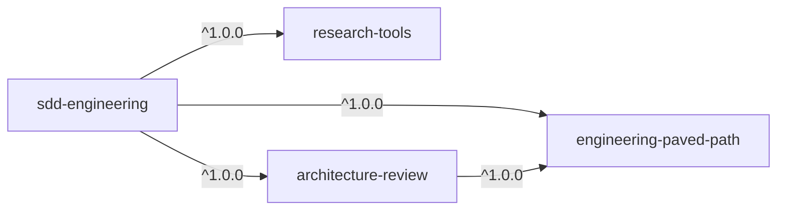

# Spec: SDD Plugin Suite — moving the DevDigest SDD agents into the marketplace as plugins
Spec ID: SPEC-2026-10-25-sdd-plugin-suite
Status: draft
Supersedes: —
Modules: plugins/sdd-engineering, plugins/research-tools, plugins/architecture-review, plugins/engineering-paved-path, marketplace
Source: `/Users/andrii/sources/dev-digest/.claude/` (agents, skills, hooks) and `scripts/`
Design: slides "Step 2–5" (component selection, dependency graph, packaging, registration)

## Problem and user
The DevDigest repo has a working SDD pipeline of subagents and skills in `.claude/`:
spec-creator → implementation-planner → `/run-plan` (implementer per task, waves) →
plan-verifier + architecture-reviewer → `/workflow-retro`. It is tied to DevDigest:
the paths `specs/`, `specs/plans/`, `scripts/check.sh`, `TESTING.md`, `INSIGHTS.md`, the modules
`server/ client/ reviewer-core/ mcp/`, `pnpm arch:check`. Because of that it cannot run in
another repo.

The user is a team engineer in any repo. They want to install the SDD pipeline with one
command, and to use `researcher`, `architecture-reviewer` and the stack skills (React, Next.js,
Fastify, etc.) on their own too, without SDD.

## Goals / Non-goals
**Goals**
- Four plugins in `plugins/` with a dependency graph (§Dependency graph). The first release
  of each has version `1.0.0`.
- `sdd-engineering` contains 4 agents, the skills `run-plan` and `workflow-retro`, evals and
  documentation (README + CHANGELOG).
- No DevDigest paths or rules in agents and skills: explicit inputs with defaults replace
  them (§Generalization).
- Skills from other plugins are called only through their namespace, for example
  `engineering-paved-path:react-best-practices`.
- Scripts that accompany a skill live in the skill folder and are called through
  `${CLAUDE_SKILL_DIR}`, not through `.claude/skills/`.
- Four entries in `.claude-plugin/marketplace.json`. The catalog state is pinned by a commit and tags.

**Non-goals (not moved)**
- DevDigest product specs (`specs/*.md`, `specs/plans/*.md`, `docs/agent-prompts/`).
- Secrets, the DevDigest `.mcp.json`, `settings.local.json`.
- Cache: the `scripts/check.sh` cache, `.claude/worktrees/`, `.claude/retros/`, `reports/`.
- DevDigest-specific instructions: `client-testing`, `pr-self-review`,
  `engineering-insights`, the `INJECTION_GUARD`, `vendor/shared`, `SecretsProvider` rules.
- Agents outside the selection: `spec-reviewer`, `test-writer`, `doc-writer`. References to them
  from the agents being moved are removed.

## Dependency graph



| Plugin | Provides | Depends on |
| :- | :- | :- |
| `engineering-paved-path` | skills: React, Next.js, Fastify, architecture, testing, security (§Skills) | — |
| `research-tools` | read-only agent `researcher` | — |
| `architecture-review` | generalized agent `architecture-reviewer` | `engineering-paved-path` `^1.0.0` |
| `sdd-engineering` | agents `spec-creator`, `implementation-planner`, `implementer`, `plan-verifier`; skills `run-plan`, `workflow-retro`, `spec-authoring`*; evals | all three, `^1.0.0` |

\* `spec-authoring` merges the skills that only SDD uses (see §Skills).

`architecture-reviewer` relies on `onion-architecture`, `react-best-practices`,
`next-best-practices`, `fastify-best-practices` and `security`, so `architecture-review`
hard-depends on `engineering-paved-path` (decision 2026-10-25). `research-tools`
is self-contained: `researcher` uses no skills.

**How agents load skills.** The documentation does not confirm that the `skills:` frontmatter
accepts a skill from another plugin. So agents do not use `skills:` for other plugins' skills;
instead, as their first step, they call the Skill tool by full name
(`engineering-paved-path:onion-architecture`). `Skill` must be in the agent's `tools`.

**Public content.** Agents, skills, scripts and READMEs contain no mention of DevDigest, of
paths of a specific repo (`server/`, `client/`, `reviewer-core/`, `mcp/`, `vendor/shared`) or
of its rules. Examples in the text are neutral (`src/modules/orders/…`). AC4 checks this.

## Skills: what goes where

| Source (`dev-digest/.claude/skills/`) | Destination | Used by |
| :- | :- | :- |
| `react-best-practices`, `next-best-practices` | `engineering-paved-path` | planner, implementer, verifier, architecture-reviewer |
| `fastify-best-practices` | `engineering-paved-path` | same |
| `onion-architecture` (generalize: no `server/`, `pnpm arch:check` → input) | `engineering-paved-path` | planner, verifier, architecture-reviewer |
| `react-testing-library` | `engineering-paved-path` (testing) | implementer |
| `security` | `engineering-paved-path` | spec-creator, implementer |
| `typescript-expert`, `zod`, `drizzle-orm-patterns`, `postgresql-table-design` | not moved (decision 2026-10-25); remove the `typescript-expert` preload from architecture-reviewer | — |
| `ears-requirements`, `ux-states-review`, `llm-trust-boundaries` | `sdd-engineering` (spec-creator only); remove DevDigest UI conventions | spec-creator |
| `mermaid-diagram` | `sdd-engineering`, optional | spec-creator |
| `client-testing`, `pr-self-review`, `engineering-insights` | not moved | — |

Third-party skills (`skills-lock.json`: mcollina/skills, vercel-labs/next-skills,
sickn33/antigravity-awesome-skills, pproenca/dot-skills,
giuseppe-trisciuoglio/developer-kit, wshobson/agents) are moved only if their license
allows it. The source and license of each are recorded in
`engineering-paved-path/THIRD_PARTY_NOTICES.md`.

## Generalization (DevDigest paths → explicit inputs)

| Was in DevDigest | Becomes |
| :- | :- |
| `specs/`, `<module>/specs/`, `specs/_template.md` | input `specs_dir:` (default `specs/`); the spec template lives in the plugin: `${CLAUDE_SKILL_DIR}/templates/spec.md` |
| `specs/plans/<feature>.md`, `specs/plans/_template.md` | input `plans_dir:` (default `specs/plans/`); the plan template lives in the plugin |
| `specs/plans/reports/<feature>/` | input `reports_dir:` (default `<plans_dir>/reports/`) |
| `scripts/check.sh <pkg> <step>` | the `Verify` commands from the plan. The planner takes them from the repo's `CLAUDE.md`/`package.json` or asks the user |
| `scripts/plan-lint.mjs` | `skills/run-plan/scripts/plan-lint.mjs`, called via `node "${CLAUDE_SKILL_DIR}/scripts/plan-lint.mjs"`; remove the "use scripts/check.sh" rule |
| `scripts/workflow-stats.mjs` | `skills/workflow-retro/scripts/workflow-stats.mjs` via `${CLAUDE_SKILL_DIR}` |
| `scripts/save-designs.mjs`, `specs/designs/<date>-<slug>/D<n>.png` | `skills/spec-authoring/scripts/save-designs.mjs` via `${CLAUDE_SKILL_DIR}`; input `designs_dir:` (default `<specs_dir>/designs/`) |
| `scripts/worktree-bootstrap.sh` | input `bootstrap:` (command that installs dependencies in a worktree, optional) |
| `pnpm arch:check` (dependency-cruiser) | input `arch_check:` (optional; without it, manual rules only) |
| `TESTING.md` (lanes) | input `testing_doc:` (optional); without it, labels `[unit|it|e2e|manual]` without binding to files |
| modules `server/ client/ reviewer-core/ mcp/`, tags `[SHARED|BE|FE]` | modules from the repo's `CLAUDE.md`/structure; the tags stay |
| module `CLAUDE.md`/`INSIGHTS.md` | read if present; `INSIGHTS.md` is optional |
| `.claude/retros/` | input `retros_dir:` (default `.claude/retros/`) |
| `Agent(researcher)` in `spec-creator` | `Agent(research-tools:researcher)` |
| agent calls in `run-plan` | `sdd-engineering:implementer`, `sdd-engineering:plan-verifier`, `architecture-review:architecture-reviewer`; `/code-review high` stays |
| references to `spec-reviewer`, `doc-writer`, `test-writer`, `pr-self-review` | remove, or mark as optional external steps |

### Guard hooks
Plugin agents ignore the `hooks` field in frontmatter (as well as `permissionMode` and
`mcpServers`). So `spec-creator-guard.sh` and `implementation-planner-guard.sh`
move into `sdd-engineering/hooks/hooks.json` as `PreToolUse` with the matcher
`Write|Edit|MultiEdit`, and the scripts go into `sdd-engineering/hooks/scripts/`. A plugin hook
fires in every session, so the script's first step lets through everything where `agent_type` in
stdin is not `sdd-engineering:spec-creator` or
`sdd-engineering:implementation-planner`. The allowed paths come from the same
`specs_dir`/`plans_dir` defaults.

## Repository structure
```text
.claude-plugin/marketplace.json
plugins/
  engineering-paved-path/
    .claude-plugin/plugin.json
    skills/{react-best-practices,next-best-practices,fastify-best-practices,
            onion-architecture,react-testing-library,security,...}/
    README.md  CHANGELOG.md  LICENSE  THIRD_PARTY_NOTICES.md
  research-tools/
    .claude-plugin/plugin.json
    agents/researcher.md
    README.md  CHANGELOG.md  LICENSE
  architecture-review/
    .claude-plugin/plugin.json
    agents/architecture-reviewer.md
    README.md  CHANGELOG.md  LICENSE
  sdd-engineering/
    .claude-plugin/plugin.json             # dependencies: 3 × ^1.0.0
    agents/{spec-creator,implementation-planner,implementer,plan-verifier}.md
    skills/run-plan/{SKILL.md,references/{execute,review-fix,finish}.md,
                     scripts/plan-lint.mjs,templates/plan.md}
    skills/workflow-retro/{SKILL.md,scripts/workflow-stats.mjs}
    skills/spec-authoring/{SKILL.md,templates/spec.md,scripts/save-designs.mjs,...}   # ears, ux-states, llm-trust
    hooks/hooks.json  hooks/scripts/{spec-creator,implementation-planner}-guard.sh
    evals/
    README.md  CHANGELOG.md  LICENSE
```

`sdd-engineering/.claude-plugin/plugin.json`:
```json
{
  "name": "sdd-engineering",
  "displayName": "SDD Engineering",
  "version": "1.0.0",
  "description": "Spec Driven Development: spec, plan, run-plan, verify, retro",
  "author": { "name": "aptrnk1" },
  "license": "MIT",
  "keywords": ["sdd", "spec", "planning", "tdd"],
  "dependencies": [
    { "name": "engineering-paved-path", "version": "^1.0.0" },
    { "name": "research-tools", "version": "^1.0.0" },
    { "name": "architecture-review", "version": "^1.0.0" }
  ]
}
```

## Registration, versions and releases
- `marketplace.json` has four entries, each with `name`, `source: "./plugins/<name>"`,
  `author`, `description`, `category: "engineering"`. `owner` is set at the
  marketplace level; in a plugin entry `author` plays that role.
- `version` is set only in `plugin.json`; the marketplace entry has none
  ([ADR-0002](../docs/adr/0002-versioning-strategy.md)).
- Each plugin has a `CHANGELOG.md` in Keep a Changelog format. At the top `## [Unreleased]`,
  the first entry `## [1.0.0] - <date>` lists what was moved and links to the source
  commit in dev-digest.
- A release goes: bump the version in `plugin.json` → CHANGELOG → merge into `main` → tag
  `<plugin>--v<version>` (`git tag` or `claude plugin tag --push` in the plugin folder).
  The plugins are connected by relative path, so the range `^1.0.0` resolves against exactly
  these tags in the marketplace repo.
- Order of the first release: the three dependencies first, then `sdd-engineering`.
- Renaming an agent or skill, or changing an artifact format in a dependency, requires a major
  bump and an explicit widening of the range in `sdd-engineering`.

## `sdd-engineering` README: required sections
1. What it is and who it is for.
2. One-command install and the list of dependencies it pulls in.
3. Pipeline diagram (Mermaid): spec-creator (+ researcher) → a human sets `approved` →
   implementation-planner → a human sets `Approved` → `/sdd-engineering:run-plan` →
   implementer waves → plan-verifier ∥ architecture-reviewer ∥ `/code-review` → fix
   loop (≤3) → `/sdd-engineering:workflow-retro`.
4. Component table: agent/skill, model, stage, input, output, write access.
5. Inputs and their defaults (`specs_dir`, `plans_dir`, `reports_dir`, `bootstrap`,
   `arch_check`, `testing_doc`, `retros_dir`) and how to set them for your repo.
6. Guard hooks: what they restrict, the dependency on `jq`/`python3`, a reminder that the plugin
   runs scripts with the user's permissions.
7. Execution modes (multi-agent/single-agent) and how to resume a run from the middle.
8. Links to the CHANGELOG and the primary sources (Spec Kit, EARS, obra/superpowers, Anthropic
   "Building effective agents"), which are already cited in `dev-digest/.claude/agents/README.md`.

## Acceptance criteria
- AC1. `claude plugin validate . --strict` passes for the marketplace and for each of the 4 plugins.
- AC2. `/plugin install sdd-engineering@dev-digest` installs and enables the three dependencies.
  `claude plugin list` shows no dependency errors.
- AC3. `research-tools`, `architecture-review` and `engineering-paved-path` install and
  work on their own.
- AC4. `grep -rniE 'dev-?digest|reviewer-core|vendor/shared|scripts/check\.sh|\.claude/skills/|INJECTION_GUARD|server/src|client/src|aptrnk1/dev'
  plugins/` finds nothing in agents, skills and scripts. Only provenance lines in CHANGELOG and
  THIRD_PARTY_NOTICES are allowed.
- AC4a. Each of the 4 plugins has a README: what it provides, how to install it, how to call each
  agent or skill (with an example), inputs and defaults, dependencies, limitations.
- AC5. Every call to another plugin's skill or agent in `plugins/` uses the namespaced name
  (`<plugin>:<name>`).
- AC6. `run-plan` and `workflow-retro` run their scripts through
  `${CLAUDE_SKILL_DIR}/scripts/…` and work in a repo without `scripts/` at the root.
- AC7. The guard hook blocks `sdd-engineering:spec-creator` from writing outside `specs_dir` and
  does not affect the main session or other agents.
- AC8. `researcher`, `plan-verifier` and `architecture-reviewer` have
  `disallowedTools: Write, Edit, NotebookEdit`.
- AC9. `claude plugin eval plugins/sdd-engineering` passes. Evals are written from scratch, at least
  one case for each of the 4 agents and 2 workflow skills; in `research-tools` and
  `architecture-review`, one case per agent.
- AC10. Tags `<plugin>--v1.0.0` exist for all four plugins. Each plugin has a
  README, CHANGELOG and LICENSE, and the root `README.md` lists them in a table.

## Risks
- **`agent_type` in the hook's stdin.** The hooks documentation confirms that `PreToolUse` in a
  subagent receives `agent_type`, and for a plugin agent it has the form `<plugin>:<agent>`.
  Risk closed; a live-run check remains.
- **`Agent(research-tools:researcher)` in `tools`.** The documentation shows `Agent(name)` only with
  simple names. If the namespaced name does not work, `spec-creator` gets an unrestricted `Agent`,
  and the prompt allows calling only `research-tools:researcher`.
- **A subagent does not launch subagents.** `spec-creator` calls `researcher` only when it is the
  main session (`claude --agent sdd-engineering:spec-creator`); otherwise it returns a
  `needs-research` block. We keep this behaviour and explain it in the README.
- **Third-party skill licenses.** A skill without a compatible license is not moved; the README
  links to the original source instead.
- **Bash read-only rests only on the prompt** in `plan-verifier` and
  `architecture-reviewer`, as in the source.

## Decisions (2026-10-25)
1. Evals are written from scratch for `claude plugin eval` (AC9).
2. `typescript-expert`, `zod`, `drizzle-orm-patterns` and `postgresql-table-design` are not
   moved. `engineering-paved-path` contains only React, Next.js, Fastify, architecture,
   testing and security.
3. `save-designs.mjs` moves into `sdd-engineering/skills/spec-authoring/scripts/`.
4. Specs are written in English (changed in sdd-engineering 1.1.0; the source was Ukrainian). Readers still accept the legacy Ukrainian headings. No language input is added.

## Open questions
— (none)
