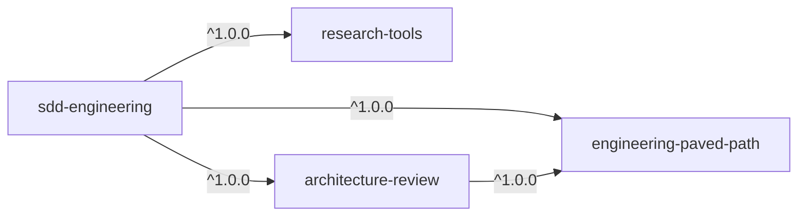

# Spec: SDD Plugin Suite — перенесення SDD-агентів DevDigest у маркетплейс плагінами
Spec ID: SPEC-2026-10-25-sdd-plugin-suite
Status: draft
Supersedes: —
Modules: plugins/sdd-engineering, plugins/research-tools, plugins/architecture-review, plugins/engineering-paved-path, marketplace
Source: `/Users/andrii/sources/dev-digest/.claude/` (agents, skills, hooks) і `scripts/`
Design: слайди «Крок 2–5» (відбір компонентів, dependency graph, пакування, реєстрація)

## Проблема й користувач
У репо DevDigest є робочий SDD-конвеєр із сабагентів і skills у `.claude/`:
spec-creator → implementation-planner → `/run-plan` (implementer по задачах, хвилі) →
plan-verifier + architecture-reviewer → `/workflow-retro`. Він прив'язаний до DevDigest:
шляхи `specs/`, `specs/plans/`, `scripts/check.sh`, `TESTING.md`, `INSIGHTS.md`, модулі
`server/ client/ reviewer-core/ mcp/`, `pnpm arch:check`. Через це в іншому репо його не
запустиш.

Користувач — інженер команди в будь-якому репо. Він хоче однією командою поставити
SDD-конвеєр, а `researcher`, `architecture-reviewer` і стекові skills (React, Next.js,
Fastify тощо) використовувати й окремо, без SDD.

## Goals / Non-goals
**Goals**
- Чотири плагіни в `plugins/` з графом залежностей (§Dependency graph). Перший реліз
  кожного має версію `1.0.0`.
- `sdd-engineering` містить 4 агенти, skills `run-plan` і `workflow-retro`, evals і
  документацію (README + CHANGELOG).
- Жодних DevDigest-шляхів і правил в агентах і skills: їх замінюють явні inputs із
  дефолтами (§Узагальнення).
- Skills з інших плагінів викликаються лише через namespace, наприклад
  `engineering-paved-path:react-best-practices`.
- Скрипти, що супроводжують skill, лежать у теці skill і викликаються через
  `${CLAUDE_SKILL_DIR}`, а не через `.claude/skills/`.
- Чотири записи в `.claude-plugin/marketplace.json`. Стан каталогу фіксують коміт і теги.

**Non-goals (не переносимо)**
- Product specs DevDigest (`specs/*.md`, `specs/plans/*.md`, `docs/agent-prompts/`).
- Secrets, `.mcp.json` DevDigest, `settings.local.json`.
- Cache: кеш `scripts/check.sh`, `.claude/worktrees/`, `.claude/retros/`, `reports/`.
- DevDigest-specific instructions: `client-testing`, `pr-self-review`,
  `engineering-insights`, правила `INJECTION_GUARD`, `vendor/shared`, `SecretsProvider`.
- Агенти поза відбором: `spec-reviewer`, `test-writer`, `doc-writer`. Посилання на них
  з агентів, що переносяться, прибираємо.

## Dependency graph



| Плагін | Що постачає | Залежить від |
| :- | :- | :- |
| `engineering-paved-path` | skills: React, Next.js, Fastify, architecture, testing, security (§Skills) | — |
| `research-tools` | read-only агент `researcher` | — |
| `architecture-review` | узагальнений агент `architecture-reviewer` | `engineering-paved-path` `^1.0.0` |
| `sdd-engineering` | агенти `spec-creator`, `implementation-planner`, `implementer`, `plan-verifier`; skills `run-plan`, `workflow-retro`, `spec-authoring`*; evals | усі три, `^1.0.0` |

\* `spec-authoring` об'єднує skills, які використовує лише SDD (див. §Skills).

`architecture-reviewer` спирається на `onion-architecture`, `react-best-practices`,
`next-best-practices`, `fastify-best-practices` і `security`, тому `architecture-review`
жорстко залежить від `engineering-paved-path` (рішення 2026-10-25). `research-tools`
самодостатній: `researcher` не використовує skills.

**Як агенти підвантажують skills.** Документація не підтверджує, що frontmatter `skills:`
приймає skill з іншого плагіна. Тому агенти не використовують `skills:` для чужих skills,
а першим кроком викликають Skill tool за повним іменем
(`engineering-paved-path:onion-architecture`). `Skill` має бути в `tools` агента.

**Публічність.** Агенти, skills, скрипти й README не містять згадок DevDigest, шляхів
конкретного репо (`server/`, `client/`, `reviewer-core/`, `mcp/`, `vendor/shared`) чи його
правил. Приклади в тексті — нейтральні (`src/modules/orders/…`). Перевіряє це AC4.

## Skills: що куди

| Джерело (`dev-digest/.claude/skills/`) | Куди | Хто використовує |
| :- | :- | :- |
| `react-best-practices`, `next-best-practices` | `engineering-paved-path` | planner, implementer, verifier, architecture-reviewer |
| `fastify-best-practices` | `engineering-paved-path` | те саме |
| `onion-architecture` (узагальнити: без `server/`, `pnpm arch:check` → input) | `engineering-paved-path` | planner, verifier, architecture-reviewer |
| `react-testing-library` | `engineering-paved-path` (testing) | implementer |
| `security` | `engineering-paved-path` | spec-creator, implementer |
| `typescript-expert`, `zod`, `drizzle-orm-patterns`, `postgresql-table-design` | не переносимо (рішення 2026-10-25); preload `typescript-expert` в architecture-reviewer прибрати | — |
| `ears-requirements`, `ux-states-review`, `llm-trust-boundaries` | `sdd-engineering` (лише spec-creator); прибрати DevDigest UI-конвенції | spec-creator |
| `mermaid-diagram` | `sdd-engineering`, опційно | spec-creator |
| `client-testing`, `pr-self-review`, `engineering-insights` | не переносимо | — |

Сторонні skills (`skills-lock.json`: mcollina/skills, vercel-labs/next-skills,
sickn33/antigravity-awesome-skills, pproenca/dot-skills,
giuseppe-trisciuoglio/developer-kit, wshobson/agents) переносимо, лише якщо ліцензія це
дозволяє. Джерело й ліцензія кожного фіксуються в
`engineering-paved-path/THIRD_PARTY_NOTICES.md`.

## Узагальнення (DevDigest paths → явні inputs)

| Було в DevDigest | Стає |
| :- | :- |
| `specs/`, `<module>/specs/`, `specs/_template.md` | input `specs_dir:` (дефолт `specs/`); шаблон спеки лежить у плагіні: `${CLAUDE_SKILL_DIR}/templates/spec.md` |
| `specs/plans/<feature>.md`, `specs/plans/_template.md` | input `plans_dir:` (дефолт `specs/plans/`); шаблон плану в плагіні |
| `specs/plans/reports/<feature>/` | input `reports_dir:` (дефолт `<plans_dir>/reports/`) |
| `scripts/check.sh <pkg> <step>` | команди `Verify` з плану. Planner бере їх з `CLAUDE.md`/`package.json` репо або питає користувача |
| `scripts/plan-lint.mjs` | `skills/run-plan/scripts/plan-lint.mjs`, виклик через `node "${CLAUDE_SKILL_DIR}/scripts/plan-lint.mjs"`; правило «use scripts/check.sh» прибрати |
| `scripts/workflow-stats.mjs` | `skills/workflow-retro/scripts/workflow-stats.mjs` через `${CLAUDE_SKILL_DIR}` |
| `scripts/save-designs.mjs`, `specs/designs/<date>-<slug>/D<n>.png` | `skills/spec-authoring/scripts/save-designs.mjs` через `${CLAUDE_SKILL_DIR}`; input `designs_dir:` (дефолт `<specs_dir>/designs/`) |
| `scripts/worktree-bootstrap.sh` | input `bootstrap:` (команда встановлення залежностей у worktree, опційно) |
| `pnpm arch:check` (dependency-cruiser) | input `arch_check:` (опційно; без нього лише ручні правила) |
| `TESTING.md` (лейни) | input `testing_doc:` (опційно); без нього мітки `[unit|it|e2e|manual]` без прив'язки до файлів |
| модулі `server/ client/ reviewer-core/ mcp/`, теги `[SHARED|BE|FE]` | модулі з `CLAUDE.md`/структури репо, теги лишаються |
| `CLAUDE.md`/`INSIGHTS.md` модулів | читати, якщо є; `INSIGHTS.md` необов'язковий |
| `.claude/retros/` | input `retros_dir:` (дефолт `.claude/retros/`) |
| `Agent(researcher)` у `spec-creator` | `Agent(research-tools:researcher)` |
| виклики агентів у `run-plan` | `sdd-engineering:implementer`, `sdd-engineering:plan-verifier`, `architecture-review:architecture-reviewer`; `/code-review high` лишається |
| посилання на `spec-reviewer`, `doc-writer`, `test-writer`, `pr-self-review` | прибрати або позначити як опційні зовнішні кроки |

### Guard-хуки
Plugin-агенти ігнорують поле `hooks` у frontmatter (а також `permissionMode` і
`mcpServers`). Тому `spec-creator-guard.sh` і `implementation-planner-guard.sh`
переносимо в `sdd-engineering/hooks/hooks.json` як `PreToolUse` з matcher
`Write|Edit|MultiEdit`, а скрипти кладемо в `sdd-engineering/hooks/scripts/`. Plugin-хук
спрацьовує в усіх сесіях, тож скрипт першим кроком пропускає все, де `agent_type` у
stdin не дорівнює `sdd-engineering:spec-creator` чи
`sdd-engineering:implementation-planner`. Дозволені шляхи беруться з тих самих
дефолтів `specs_dir`/`plans_dir`.

## Структура репозиторію
```text
.claude-plugin/marketplace.json
plugins/
  engineering-paved-path/
    .claude-plugin/plugin.json
    skills/{react-best-practices,next-best-practices,fastify-best-practices,
            onion-architecture,react-testing-library,security,...}/
    README.md  CHANGELOG.md  LICENSE  THIRD_PARTY_NOTICES.md
  research-tools/
    .claude-plugin/plugin.json
    agents/researcher.md
    README.md  CHANGELOG.md  LICENSE
  architecture-review/
    .claude-plugin/plugin.json
    agents/architecture-reviewer.md
    README.md  CHANGELOG.md  LICENSE
  sdd-engineering/
    .claude-plugin/plugin.json             # dependencies: 3 × ^1.0.0
    agents/{spec-creator,implementation-planner,implementer,plan-verifier}.md
    skills/run-plan/{SKILL.md,references/{execute,review-fix,finish}.md,
                     scripts/plan-lint.mjs,templates/plan.md}
    skills/workflow-retro/{SKILL.md,scripts/workflow-stats.mjs}
    skills/spec-authoring/{SKILL.md,templates/spec.md,scripts/save-designs.mjs,...}   # ears, ux-states, llm-trust
    hooks/hooks.json  hooks/scripts/{spec-creator,implementation-planner}-guard.sh
    evals/
    README.md  CHANGELOG.md  LICENSE
```

`sdd-engineering/.claude-plugin/plugin.json`:
```json
{
  "name": "sdd-engineering",
  "displayName": "SDD Engineering",
  "version": "1.0.0",
  "description": "Spec Driven Development: spec, plan, run-plan, verify, retro",
  "author": { "name": "aptrnk1" },
  "license": "MIT",
  "keywords": ["sdd", "spec", "planning", "tdd"],
  "dependencies": [
    { "name": "engineering-paved-path", "version": "^1.0.0" },
    { "name": "research-tools", "version": "^1.0.0" },
    { "name": "architecture-review", "version": "^1.0.0" }
  ]
}
```

## Реєстрація, версії й релізи
- У `marketplace.json` чотири записи, у кожному `name`, `source: "./plugins/<name>"`,
  `author`, `description`, `category: "engineering"`. `owner` задається на
  рівні маркетплейсу, у записі плагіна цю роль виконує `author`.
- `version` вказуємо лише в `plugin.json`, у записі маркетплейсу його немає
  ([ADR-0002](../docs/adr/0002-versioning-strategy.md)).
- `CHANGELOG.md` у кожному плагіні у форматі Keep a Changelog. Зверху `## [Unreleased]`,
  перший запис `## [1.0.0] - <дата>` з переліком перенесеного й посиланням на коміт
  джерела в dev-digest.
- Реліз іде так: bump версії в `plugin.json` → CHANGELOG → merge у `main` → тег
  `<plugin>--v<version>` (`git tag` або `claude plugin tag --push` у теці плагіна).
  Плагіни підключені за relative path, тому діапазон `^1.0.0` резолвиться саме за цими
  тегами в репо маркетплейсу.
- Порядок першого релізу: спершу три залежності, потім `sdd-engineering`.
- Перейменування агента чи skill або зміна формату артефакту в залежності вимагає bump
  major і явного розширення діапазону в `sdd-engineering`.

## README `sdd-engineering`: обов'язкові розділи
1. Що це і для кого.
2. Встановлення однією командою і перелік залежностей, що підтягнуться.
3. Схема конвеєра (Mermaid): spec-creator (+ researcher) → людина ставить `approved` →
   implementation-planner → людина ставить `Approved` → `/sdd-engineering:run-plan` →
   хвилі implementer → plan-verifier ∥ architecture-reviewer ∥ `/code-review` → цикл
   виправлень (≤3) → `/sdd-engineering:workflow-retro`.
4. Таблиця компонентів: агент/skill, модель, етап, вхід, вихід, доступ на запис.
5. Inputs і їхні дефолти (`specs_dir`, `plans_dir`, `reports_dir`, `bootstrap`,
   `arch_check`, `testing_doc`, `retros_dir`) і як задати їх для свого репо.
6. Guard-хуки: що обмежують, залежність від `jq`/`python3`, нагадування, що плагін
   запускає скрипти з правами користувача.
7. Режими виконання (multi-agent/single-agent) і як продовжити прогін з середини.
8. Посилання на CHANGELOG і першоджерела (Spec Kit, EARS, obra/superpowers, Anthropic
   «Building effective agents»), які вже наведені в `dev-digest/.claude/agents/README.md`.

## Acceptance criteria
- AC1. `claude plugin validate . --strict` проходить для маркетплейсу й кожного з 4 плагінів.
- AC2. `/plugin install sdd-engineering@dev-digest` ставить і вмикає три залежності.
  `claude plugin list` не показує помилок залежностей.
- AC3. `research-tools`, `architecture-review` і `engineering-paved-path` ставляться й
  працюють поодинці.
- AC4. `grep -rniE 'dev-?digest|reviewer-core|vendor/shared|scripts/check\.sh|\.claude/skills/|INJECTION_GUARD|server/src|client/src|aptrnk1/dev'
  plugins/` нічого не знаходить в агентах, skills і скриптах. Дозволені лише рядки про
  походження в CHANGELOG і THIRD_PARTY_NOTICES.
- AC4a. Кожен із 4 плагінів має README: що він дає, як встановити, як викликати кожен
  агент чи skill (з прикладом), inputs і дефолти, залежності, обмеження.
- AC5. Кожен виклик чужого skill чи агента в `plugins/` використовує namespaced ім'я
  (`<plugin>:<name>`).
- AC6. `run-plan` і `workflow-retro` запускають свої скрипти через
  `${CLAUDE_SKILL_DIR}/scripts/…` і працюють у репо без `scripts/` у корені.
- AC7. Guard-хук блокує запис `sdd-engineering:spec-creator` поза `specs_dir` і не
  впливає на головну сесію та інших агентів.
- AC8. `researcher`, `plan-verifier` і `architecture-reviewer` мають
  `disallowedTools: Write, Edit, NotebookEdit`.
- AC9. `claude plugin eval plugins/sdd-engineering` проходить. Evals пишемо нові, мінімум по
  одному кейсу на кожен з 4 агентів і 2 workflow-skills; у `research-tools` і
  `architecture-review` по одному кейсу на агента.
- AC10. Існують теги `<plugin>--v1.0.0` для всіх чотирьох плагінів. Кожен плагін має
  README, CHANGELOG і LICENSE, а кореневий `README.md` перелічує їх у таблиці.

## Ризики
- **`agent_type` у stdin хука.** Документація хуків підтверджує, що `PreToolUse` у
  сабагенті отримує `agent_type`, а для plugin-агента він має вигляд `<plugin>:<agent>`.
  Ризик закрито, лишається перевірка живим прогоном.
- **`Agent(research-tools:researcher)` у `tools`.** Документація показує `Agent(name)` лише з
  простими іменами. Якщо namespaced ім'я не спрацює, `spec-creator` отримує `Agent` без
  обмеження, а промпт дозволяє кликати лише `research-tools:researcher`.
- **Сабагент не запускає сабагентів.** `spec-creator` кличе `researcher` лише як
  головна сесія (`claude --agent sdd-engineering:spec-creator`), інакше повертає блок
  `needs-research`. Цю поведінку зберігаємо і пояснюємо в README.
- **Ліцензії сторонніх skills.** Skill без сумісної ліцензії не переносимо, а в README
  даємо посилання на першоджерело.
- **Bash read-only тримається лише на промпті** в `plan-verifier` і
  `architecture-reviewer`, як і в джерелі.

## Рішення (2026-10-25)
1. Evals пишемо нові під `claude plugin eval` (AC9).
2. `typescript-expert`, `zod`, `drizzle-orm-patterns` і `postgresql-table-design` не
   переносимо. `engineering-paved-path` містить лише React, Next.js, Fastify, architecture,
   testing і security.
3. `save-designs.mjs` переносимо в `sdd-engineering/skills/spec-authoring/scripts/`.
4. Спеки пишемо українською, як у джерелі. Input для мови не додаємо.

## Відкриті питання
— (немає)
